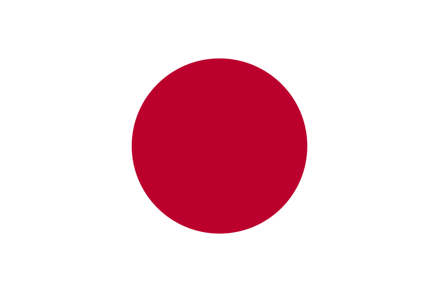

+++
title = "Around the World"
description = "A short sample quiz: capitals, planets, flags and history."
licence = "CC BY-SA 4.0"
time_limit = 20
max_points = 1000
scoring = "linear"
floor = 0.5

[[sources]]
title = "Canberra"
url = "https://en.wikipedia.org/wiki/Canberra"

[[sources]]
title = "Jupiter"
url = "https://en.wikipedia.org/wiki/Jupiter"

[[sources]]
title = "Flag of Japan"
url = "https://en.wikipedia.org/wiki/Flag_of_Japan"

[[sources]]
title = "Berlin Wall"
url = "https://en.wikipedia.org/wiki/Berlin_Wall"

[[sources]]
title = "Hexagon"
url = "https://en.wikipedia.org/wiki/Hexagon"

[[images]]
file = "images/flag.svg"
author = "Bruce's Quiz Party"
licence = "CC0 1.0"
+++

## What is the capital of Australia?

- [ ] Sydney
- [x] Canberra
- [ ] Melbourne
- [ ] Perth

Source: https://en.wikipedia.org/wiki/Canberra#History

## Which is the largest planet in the Solar System?

- [ ] Saturn
- [ ] Neptune
- [x] Jupiter
- [ ] Earth
- [ ] Uranus

Source: https://en.wikipedia.org/wiki/Jupiter

## Which country's flag is this?



- [ ] Bangladesh
- [ ] Palau
- [x] Japan
- [ ] South Korea
- [ ] Laos
- [ ] Greenland

Source: https://en.wikipedia.org/wiki/Flag_of_Japan

## In which year did the Berlin Wall fall?

- [ ] 1961
- [x] 1989
- [ ] 1991

Source: https://en.wikipedia.org/wiki/Berlin_Wall#Fall_of_the_Berlin_Wall

```toml
time_limit = 15
scoring = "logarithmic"
```

## How many sides does a hexagon have?

- [x] Six
- [ ] Eight

Source: https://en.wikipedia.org/wiki/Hexagon
