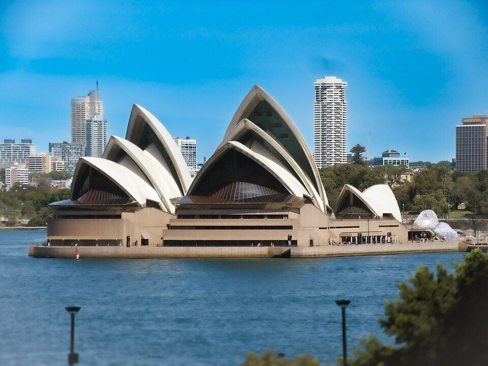

+++
title = "Brick by Famous Brick"
description = "Ten questions on the world's most famous buildings, from Roman arenas to modern skyscrapers."
licence = "CC BY-SA 4.0"
time_limit = 20
max_points = 1000
scoring = "linear"
floor = 0.5

[[sources]]
title = "Eiffel Tower"
url = "https://en.wikipedia.org/wiki/Eiffel_Tower"
revision = "2026-11-16"

[[sources]]
title = "Taj Mahal"
url = "https://en.wikipedia.org/wiki/Taj_Mahal"
revision = "2026-11-10"

[[sources]]
title = "Sydney Opera House"
url = "https://en.wikipedia.org/wiki/Sydney_Opera_House"
revision = "2026-11-18"

[[sources]]
title = "Colosseum"
url = "https://en.wikipedia.org/wiki/Colosseum"
revision = "2026-11-11"

[[sources]]
title = "Sagrada Família"
url = "https://en.wikipedia.org/wiki/Sagrada_Fam%C3%ADlia"
revision = "2026-11-18"

[[sources]]
title = "Empire State Building"
url = "https://en.wikipedia.org/wiki/Empire_State_Building"
revision = "2026-11-13"

[[sources]]
title = "Hagia Sophia"
url = "https://en.wikipedia.org/wiki/Hagia_Sophia"
revision = "2026-11-19"

[[sources]]
title = "Burj Khalifa"
url = "https://en.wikipedia.org/wiki/Burj_Khalifa"
revision = "2026-11-06"

[[sources]]
title = "Leaning Tower of Pisa"
url = "https://en.wikipedia.org/wiki/Leaning_Tower_of_Pisa"
revision = "2026-11-07"

[[sources]]
title = "Neuschwanstein Castle"
url = "https://en.wikipedia.org/wiki/Neuschwanstein_Castle"
revision = "2026-11-15"

[[images]]
file = "images/sydney-opera-house-2026.jpg"
author = "BAVhah"
licence = "CC BY-SA 4.0"
source = "https://commons.wikimedia.org/wiki/File:Sydney_Opera_House_2026.jpg"
+++

## The Eiffel Tower's local nickname is "La dame de fer". What does it mean in English?

- [x] The Iron Lady
- [ ] The Lady of Paris
- [ ] The Steel Lady
- [ ] The Grand Lady

Source: https://en.wikipedia.org/wiki/Eiffel_Tower

## Mughal emperor Shah Jahan commissioned the Taj Mahal to house the tomb of whom?

- [ ] His father
- [ ] His daughter, Gauhara Begum
- [ ] His mother
- [x] His wife, Mumtaz Mahal

Source: https://en.wikipedia.org/wiki/Taj_Mahal

## Jørn Utzon designed the building shown here. Which country was he from?

- [ ] Finland
- [ ] Norway
- [ ] Sweden
- [x] Denmark

Source: https://en.wikipedia.org/wiki/Sydney_Opera_House

## The name "Colosseum" is believed to come from a colossal statue of which Roman emperor?

- [ ] Hadrian
- [x] Nero
- [ ] Vespasian
- [ ] Titus

Source: https://en.wikipedia.org/wiki/Colosseum

## Which architect devoted the rest of his life to Barcelona's Sagrada Família and is buried in its crypt?

- [ ] Carles Buïgas
- [x] Antoni Gaudí
- [ ] Lluís Bonet i Garí
- [ ] Francesc Quintana

Source: https://en.wikipedia.org/wiki/Sagrada_Fam%C3%ADlia

## Which 1933 film first made the Empire State Building a star of the screen?

- [x] King Kong
- [ ] Frankenstein
- [ ] Metropolis
- [ ] Godzilla

Source: https://en.wikipedia.org/wiki/Empire_State_Building

## Which emperor built the current Hagia Sophia, completed in AD 537?

- [x] Justinian I
- [ ] Constantine the Great
- [ ] Constantius II
- [ ] Theodosius II

Source: https://en.wikipedia.org/wiki/Hagia_Sophia

## What was the Burj Khalifa called before its inauguration in 2010?

- [ ] Burj Emirates
- [ ] Burj Zayed
- [x] Burj Dubai
- [ ] Burj Al Arab

Source: https://en.wikipedia.org/wiki/Burj_Khalifa

## How many bells hang in the Leaning Tower of Pisa, one for each note of the major scale?

- [x] Seven
- [ ] Eight
- [ ] Twelve
- [ ] Five

Source: https://en.wikipedia.org/wiki/Leaning_Tower_of_Pisa

## King Ludwig II built Neuschwanstein Castle partly in honour of which composer?

- [x] Richard Wagner
- [ ] Richard Strauss
- [ ] Wolfgang Amadeus Mozart
- [ ] Ludwig van Beethoven

Source: https://en.wikipedia.org/wiki/Neuschwanstein_Castle
