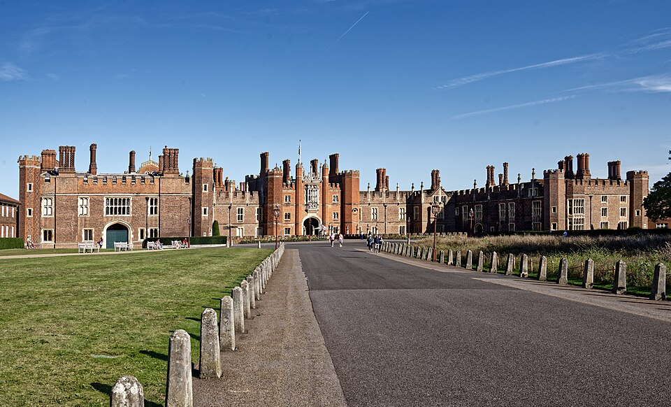
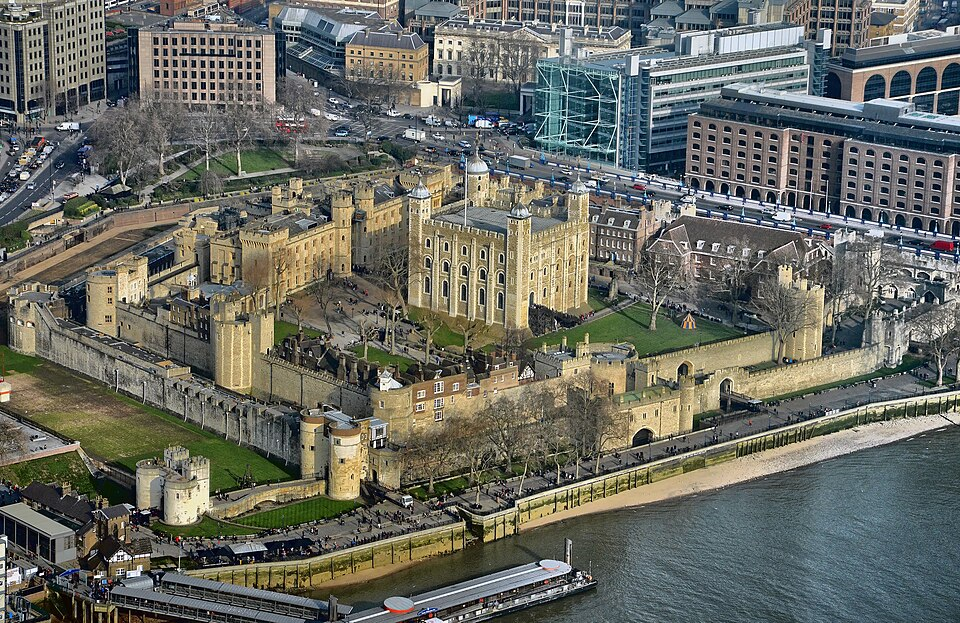
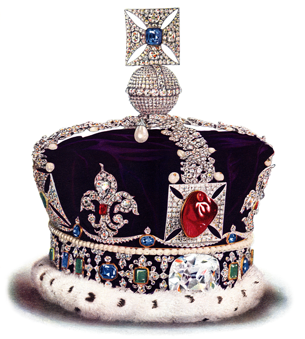

+++
title = "Crowns, Castles & Beefeaters"
description = "Test what you know about Britain's historic royal palaces, from the Tower of London to Hampton Court and beyond."
licence = "CC BY-SA 4.0"
time_limit = 20
max_points = 1000
scoring = "linear"
floor = 0.5

[[sources]]
title = "Historic Royal Palaces"
url = "https://en.wikipedia.org/wiki/Historic_Royal_Palaces"
revision = "2026-11-02"

[[sources]]
title = "Hampton Court Palace"
url = "https://en.wikipedia.org/wiki/Hampton_Court_Palace"
revision = "2026-10-30"

[[sources]]
title = "Tower of London"
url = "https://en.wikipedia.org/wiki/Tower_of_London"
revision = "2026-11-08"

[[sources]]
title = "Lucy Worsley"
url = "https://en.wikipedia.org/wiki/Lucy_Worsley"
revision = "2026-11-04"

[[sources]]
title = "Yeomen Warders"
url = "https://en.wikipedia.org/wiki/Yeomen_Warders"
revision = "2026-10-02"

[[sources]]
title = "Imperial State Crown"
url = "https://en.wikipedia.org/wiki/Imperial_State_Crown"
revision = "2026-10-12"

[[images]]
file = "images/hampton-court-palace-west-front-richmond-upon-thames-1193127-20230823-0050.jpg"
author = "Tilman2007"
licence = "CC BY-SA 4.0"
source = "https://commons.wikimedia.org/wiki/File:Hampton_Court_Palace,_West_Front_Richmond_upon_Thames_1193127_20230823_0050.jpg"

[[images]]
file = "images/tower-of-london-from-the-shard-8515883950.jpg"
author = "[Duncan] from Nottingham, UK"
licence = "CC BY 2.0"
source = "https://commons.wikimedia.org/wiki/File:Tower_of_London_from_the_Shard_(8515883950).jpg"

[[images]]
file = "images/imperial-state-crown.png"
author = "Cyril James Humphries Davenport"
licence = "Public domain"
source = "https://commons.wikimedia.org/wiki/File:Imperial_State_Crown.png"
+++

## Which cardinal began building a palace in 1514 that he later gave to Henry VIII?

- [ ] Thomas Cromwell
- [ ] Thomas More
- [x] Thomas Wolsey
- [ ] Thomas Cranmer

Source: https://en.wikipedia.org/wiki/Hampton_Court_Palace

## Which palace is this, whose gardens include a famous maze?

- [ ] Kew Palace
- [x] Hampton Court Palace
- [ ] Kensington Palace
- [ ] Hillsborough Castle

Source: https://en.wikipedia.org/wiki/Hampton_Court_Palace

## This castle's central keep, the White Tower, was built in 1078 by which king?

- [ ] Edward I
- [ ] Richard I
- [ ] Henry III
- [x] William the Conqueror

Source: https://en.wikipedia.org/wiki/Tower_of_London

## What are the Yeomen Warders of the Tower of London popularly known as?

- [ ] Kingsmen
- [ ] Grenadiers
- [x] Beefeaters
- [ ] Tudor Rosemen

Source: https://en.wikipedia.org/wiki/Yeomen_Warders

## Legend says that if the ravens ever leave the Tower, what will happen?

- [ ] The Crown Jewels will vanish
- [x] The White Tower will fall
- [ ] The King will die
- [ ] The Thames will flood

Source: https://en.wikipedia.org/wiki/Yeomen_Warders

## Which queen died at Hampton Court in 1537, two weeks after giving birth to the future Edward VI?

- [ ] Anne Boleyn
- [ ] Catherine Howard
- [x] Jane Seymour
- [ ] Anne of Cleves

Source: https://en.wikipedia.org/wiki/Hampton_Court_Palace

## The Hampton Court Conference of 1604 led the king to commission what?

- [ ] A royal navy
- [ ] A new Parliament
- [x] A new English Bible
- [ ] A new prayer book

Source: https://en.wikipedia.org/wiki/Hampton_Court_Palace

## Who painted the ceiling of the Banqueting Hall in Whitehall?

- [ ] Van Dyck
- [x] Rubens
- [ ] Rembrandt
- [ ] Holbein

Source: https://en.wikipedia.org/wiki/Historic_Royal_Palaces

## Which king was executed at the Banqueting House?

- [x] Charles I
- [ ] Henry VI
- [ ] Charles II
- [ ] James II

Source: https://en.wikipedia.org/wiki/Historic_Royal_Palaces

## Kensington Palace is advertised as the birthplace of which monarch?

- [ ] Queen Anne
- [ ] Elizabeth II
- [x] Queen Victoria
- [ ] George III

Source: https://en.wikipedia.org/wiki/Historic_Royal_Palaces

## Which architect designed William III's Baroque rebuilding of Hampton Court?

- [ ] Nicholas Hawksmoor
- [ ] John Vanbrugh
- [ ] Inigo Jones
- [x] Sir Christopher Wren

Source: https://en.wikipedia.org/wiki/Hampton_Court_Palace

## Who built the Great Pagoda at Kew in 1761?

- [ ] Robert Adam
- [x] Sir William Chambers
- [ ] Capability Brown
- [ ] John Nash

Source: https://en.wikipedia.org/wiki/Historic_Royal_Palaces

## Hillsborough Castle, also run by Historic Royal Palaces, is the King's official residence where?

- [ ] Wales
- [x] Northern Ireland
- [ ] Scotland
- [ ] Cornwall

Source: https://en.wikipedia.org/wiki/Historic_Royal_Palaces

## Which great diamond is set in the front of this crown?

- [ ] Regent Diamond
- [ ] Koh-i-Noor
- [x] Cullinan II
- [ ] Hope Diamond

Source: https://en.wikipedia.org/wiki/Imperial_State_Crown

## The 'Black Prince's Ruby' on the state crown is actually what kind of stone?

- [x] A red spinel
- [ ] Coloured glass
- [ ] A garnet
- [ ] A red diamond

Source: https://en.wikipedia.org/wiki/Imperial_State_Crown

## When the state crown fell and broke in 1845, the queen wrote it was squashed like what?

- [x] A pudding
- [ ] A hat
- [ ] A pie
- [ ] An egg

Source: https://en.wikipedia.org/wiki/Imperial_State_Crown

## Who became the first female Yeoman Warder in 2007?

- [x] Moira Cameron
- [ ] Eleri Lynn
- [ ] Tracy Borman
- [ ] Elizabeth Throckmorton

Source: https://en.wikipedia.org/wiki/Yeomen_Warders

## How many years must Yeomen Warders have served in the armed forces?

- [x] 22
- [ ] 12
- [ ] 25
- [ ] 30

Source: https://en.wikipedia.org/wiki/Yeomen_Warders

## Historian Lucy Worsley's rhotacism affects how she pronounces which letter?

- [ ] S
- [x] R
- [ ] L
- [ ] W

Source: https://en.wikipedia.org/wiki/Lucy_Worsley

## Before the 20th-century world wars, how many people were executed inside the Tower?

- [ ] 300
- [x] Seven
- [ ] 112
- [ ] 40

Source: https://en.wikipedia.org/wiki/Tower_of_London
