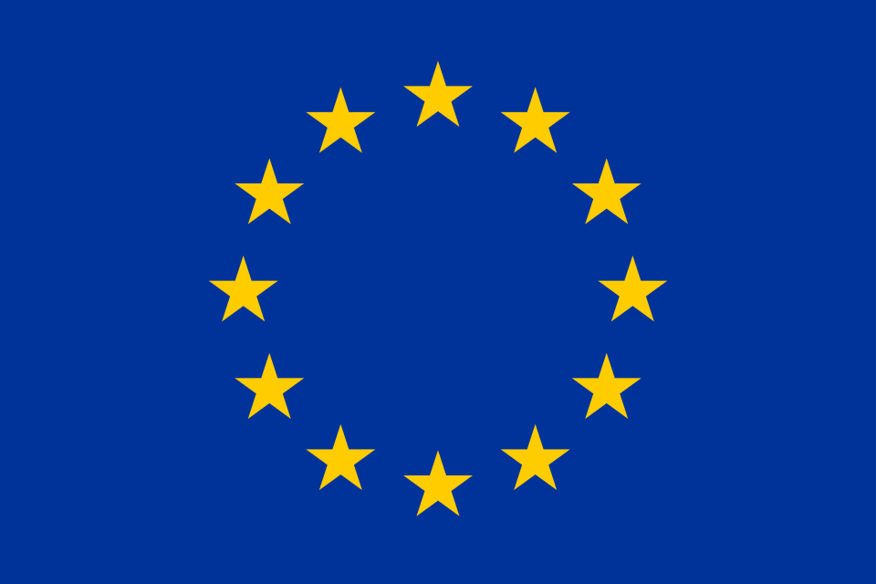

+++
title = "Flying the Flag for Europe"
description = "From Danish crosses to golden stars, test what you know about the flags of Europe."
licence = "CC BY-SA 4.0"
time_limit = 20
max_points = 1000
scoring = "linear"
floor = 0.5

[[sources]]
title = "Flag of Europe"
url = "https://en.wikipedia.org/wiki/Flag_of_Europe"
revision = "2026-11-09"

[[sources]]
title = "National flag"
url = "https://en.wikipedia.org/wiki/National_flag"
revision = "2026-10-25"

[[sources]]
title = "List of national flags of sovereign states"
url = "https://en.wikipedia.org/wiki/List_of_national_flags_of_sovereign_states"
revision = "2026-10-29"

[[images]]
file = "images/flag-of-europe.png"
author = "User:Verdy p, User:-xfi-, User:Paddu, User:Nightstallion, User:Funakoshi, User:Jeltz, User:Dbenbenn, User:Zscout370"
licence = "Public domain"
source = "https://commons.wikimedia.org/wiki/File:Flag_of_Europe.svg"
+++

## This flag was adopted in 1955 by which organisation as a symbol for the whole of Europe?

- [ ] NATO
- [x] Council of Europe
- [ ] European Union
- [ ] United Nations

Source: https://en.wikipedia.org/wiki/Flag_of_Europe

## Which country's flag, a national symbol since the 13th century, is the oldest still in use?

- [ ] Netherlands
- [ ] England
- [x] Denmark
- [ ] Switzerland

Source: https://en.wikipedia.org/wiki/List_of_national_flags_of_sovereign_states

## In 1801, which saint's cross was added to the Union Flag, giving the Union Jack its current design?

- [x] St Patrick
- [ ] St George
- [ ] St David
- [ ] St Andrew

Source: https://en.wikipedia.org/wiki/National_flag

## In which year was the flag of Switzerland introduced, based on medieval war flags?

- [ ] 1844
- [x] 1889
- [ ] 1955
- [ ] 1748

Source: https://en.wikipedia.org/wiki/National_flag

## Which country's flag is perhaps the oldest tricolour in continuous use?

- [ ] France
- [ ] Italy
- [ ] Ireland
- [x] The Netherlands

Source: https://en.wikipedia.org/wiki/National_flag

## Germany's 1949 Basic Law says the federal flag is which colours?

- [ ] Black, white and red
- [ ] Red, white and blue
- [ ] Black, red and green
- [x] Black, red and gold

Source: https://en.wikipedia.org/wiki/National_flag

## Which country objected to a 15-star European flag, as one star would imply sovereignty for the Saar?

- [x] West Germany
- [ ] France
- [ ] Turkey
- [ ] Belgium

Source: https://en.wikipedia.org/wiki/Flag_of_Europe

## A proposed European flag of one large yellow star on blue was rejected for matching which flag?

- [x] The Belgian Congo
- [ ] The Dutch East Indies
- [ ] Portuguese Angola
- [ ] The French Congo

Source: https://en.wikipedia.org/wiki/Flag_of_Europe

## The Council of Europe says the twelve stars on its flag symbolise what?

- [ ] The 12 founding members
- [ ] The 12 months of the year
- [x] Perfection and entirety
- [ ] The 12 apostles

Source: https://en.wikipedia.org/wiki/Flag_of_Europe

## In which city was the European flag unveiled on 13 December 1955?

- [x] Paris
- [ ] Rome
- [ ] Brussels
- [ ] Strasbourg

Source: https://en.wikipedia.org/wiki/Flag_of_Europe
