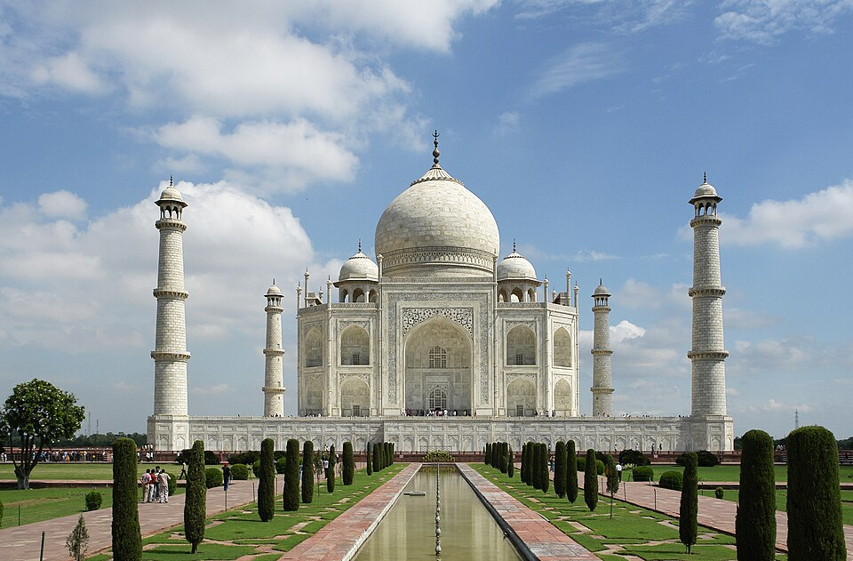
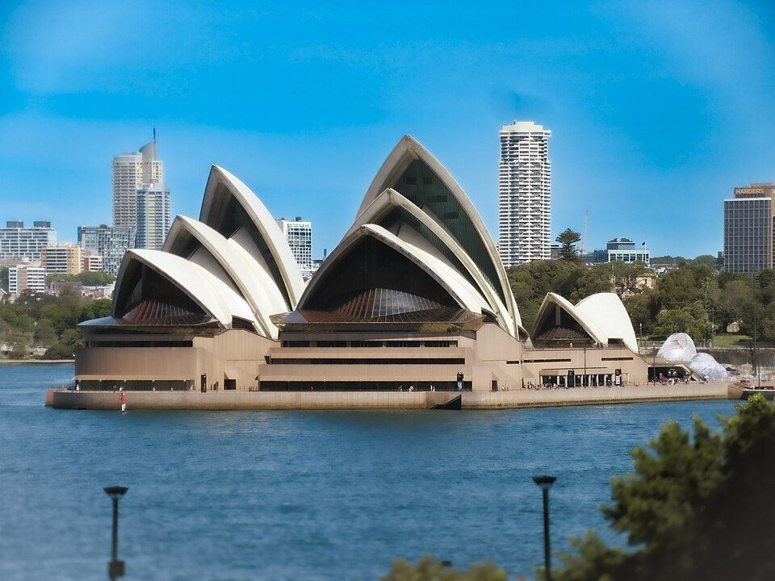

+++
title = "Name That Landmark!"
description = "From Rome to Rio, and from Moscow to Machu Picchu: can you name the world's most famous landmarks from a picture or a clue?"
licence = "CC BY-SA 4.0"
time_limit = 20
max_points = 1000
scoring = "linear"
floor = 0.5

[[sources]]
title = "Taj Mahal"
url = "https://en.wikipedia.org/wiki/Taj_Mahal"
revision = "2026-11-10"

[[sources]]
title = "Sydney Opera House"
url = "https://en.wikipedia.org/wiki/Sydney_Opera_House"
revision = "2026-11-18"

[[sources]]
title = "Colosseum"
url = "https://en.wikipedia.org/wiki/Colosseum"
revision = "2026-11-11"

[[sources]]
title = "Christ the Redeemer (statue)"
url = "https://en.wikipedia.org/wiki/Christ_the_Redeemer_(statue)"
revision = "2026-11-18"

[[sources]]
title = "Machu Picchu"
url = "https://en.wikipedia.org/wiki/Machu_Picchu"
revision = "2026-11-15"

[[sources]]
title = "Saint Basil's Cathedral"
url = "https://en.wikipedia.org/wiki/Saint_Basil%27s_Cathedral"
revision = "2026-11-17"

[[sources]]
title = "Petra"
url = "https://en.wikipedia.org/wiki/Petra"
revision = "2026-11-12"

[[sources]]
title = "Sagrada Família"
url = "https://en.wikipedia.org/wiki/Sagrada_Fam%C3%ADlia"
revision = "2026-11-18"

[[sources]]
title = "Angkor Wat"
url = "https://en.wikipedia.org/wiki/Angkor_Wat"
revision = "2026-11-07"

[[sources]]
title = "Neuschwanstein Castle"
url = "https://en.wikipedia.org/wiki/Neuschwanstein_Castle"
revision = "2026-11-15"

[[images]]
file = "images/taj-mahal-edited.jpeg"
author = "Yann; edited by Jim Carter"
licence = "CC BY-SA 4.0"
source = "https://commons.wikimedia.org/wiki/File:Taj_Mahal_(Edited).jpeg"

[[images]]
file = "images/sydney-opera-house-2026.jpg"
author = "BAVhah"
licence = "CC BY-SA 4.0"
source = "https://commons.wikimedia.org/wiki/File:Sydney_Opera_House_2026.jpg"
+++

## Name this landmark, whose mausoleum was completed in 1648.

- [ ] Angkor Wat
- [ ] Petra
- [x] Taj Mahal
- [ ] Saint Basil's Cathedral

Source: https://en.wikipedia.org/wiki/Taj_Mahal

## Name this landmark, formally opened by Queen Elizabeth II in 1973.

- [ ] Sagrada Família
- [ ] Colosseum
- [ ] Neuschwanstein Castle
- [x] Sydney Opera House

Source: https://en.wikipedia.org/wiki/Sydney_Opera_House

## Which landmark is shown on the Italian version of the 5 euro cent coin?

- [x] Colosseum
- [ ] Machu Picchu
- [ ] Petra
- [ ] Sagrada Família

Source: https://en.wikipedia.org/wiki/Colosseum

## Which landmark was struck by lightning in 2008, damaging its fingers, head and eyebrows?

- [ ] Sagrada Família
- [ ] Colosseum
- [ ] Saint Basil's Cathedral
- [x] Christ the Redeemer

Source: https://en.wikipedia.org/wiki/Christ_the_Redeemer_(statue)

## Which landmark is often called the "Lost City of the Incas"?

- [x] Machu Picchu
- [ ] Petra
- [ ] Christ the Redeemer
- [ ] Angkor Wat

Source: https://en.wikipedia.org/wiki/Machu_Picchu

## Which landmark did Ivan the Terrible order built to mark the capture of Kazan and Astrakhan?

- [x] Saint Basil's Cathedral
- [ ] Angkor Wat
- [ ] Neuschwanstein Castle
- [ ] Colosseum

Source: https://en.wikipedia.org/wiki/Saint_Basil%27s_Cathedral

## Which landmark is nicknamed the "Rose City" for the colour of the sandstone it is carved from?

- [ ] Angkor Wat
- [ ] Machu Picchu
- [x] Petra
- [ ] Taj Mahal

Source: https://en.wikipedia.org/wiki/Petra

## Whose architect is buried in its crypt, and said "My client is not in a hurry"?

- [ ] Taj Mahal
- [x] Sagrada Família
- [ ] Saint Basil's Cathedral
- [ ] Neuschwanstein Castle

Source: https://en.wikipedia.org/wiki/Sagrada_Fam%C3%ADlia

## Which landmark appears on its country's national flag?

- [x] Angkor Wat
- [ ] Petra
- [ ] Machu Picchu
- [ ] Christ the Redeemer

Source: https://en.wikipedia.org/wiki/Angkor_Wat

## Which landmark did King Ludwig II build partly in honour of the composer Richard Wagner?

- [ ] Sagrada Família
- [ ] Sydney Opera House
- [ ] Saint Basil's Cathedral
- [x] Neuschwanstein Castle

Source: https://en.wikipedia.org/wiki/Neuschwanstein_Castle
