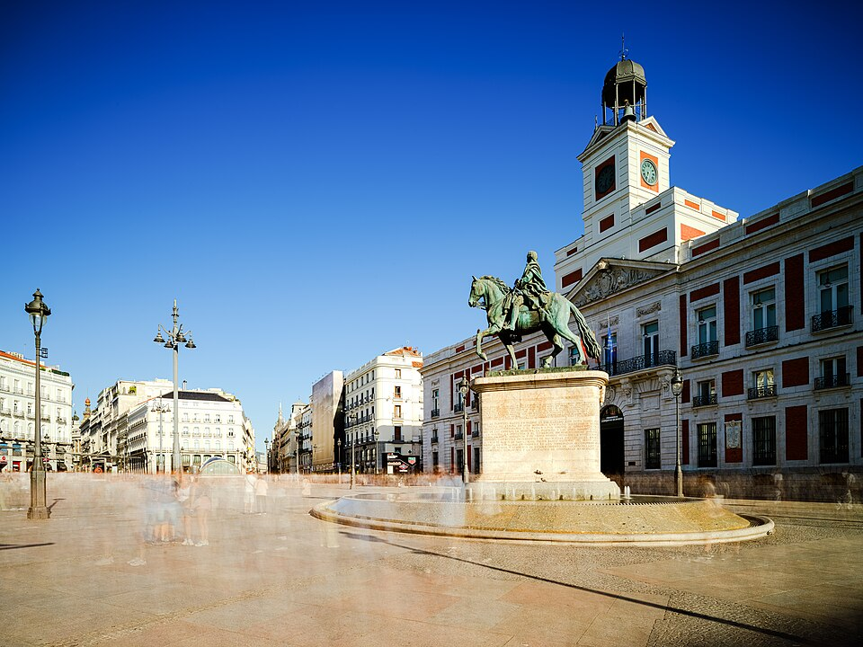
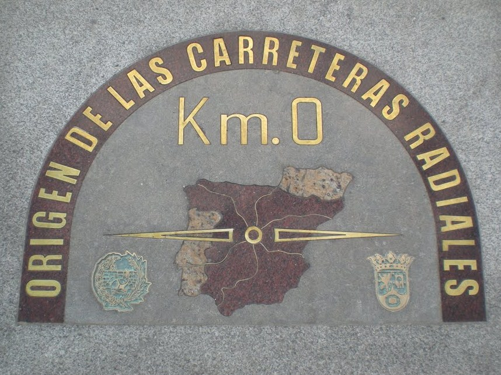
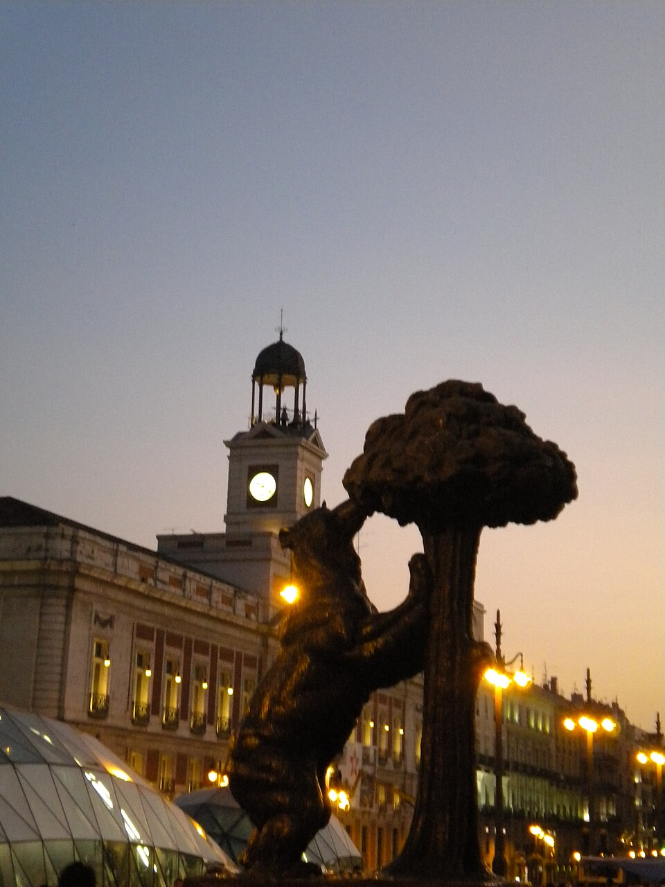
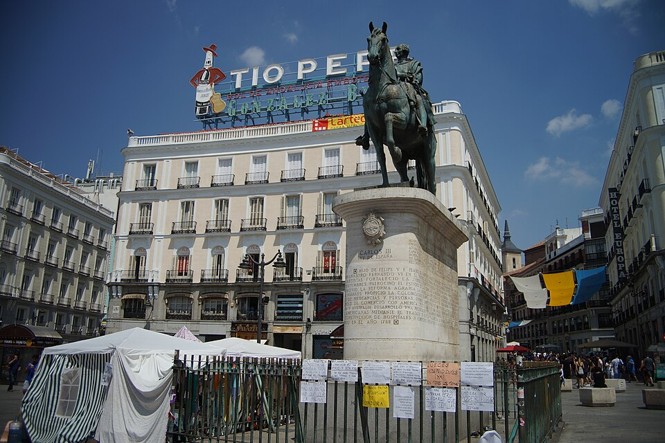
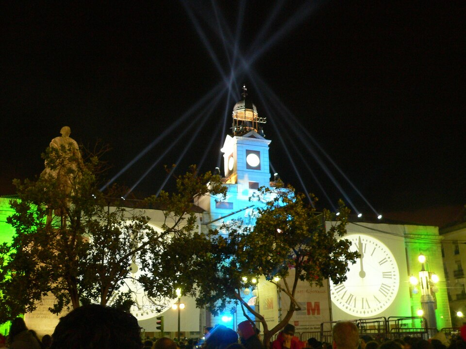
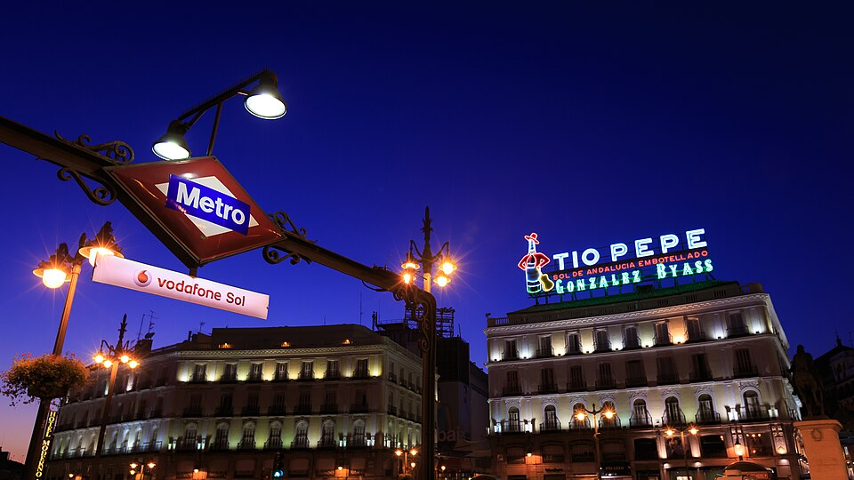
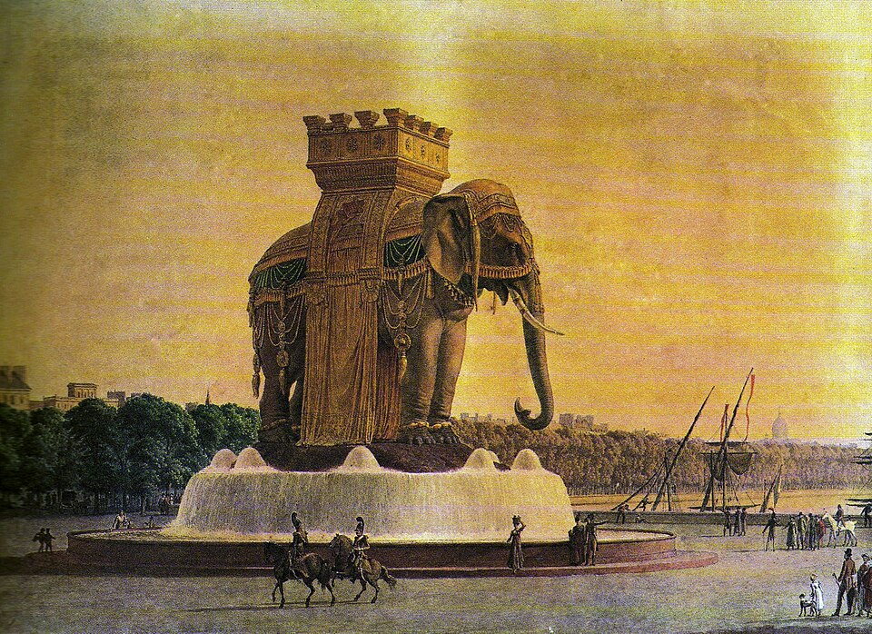
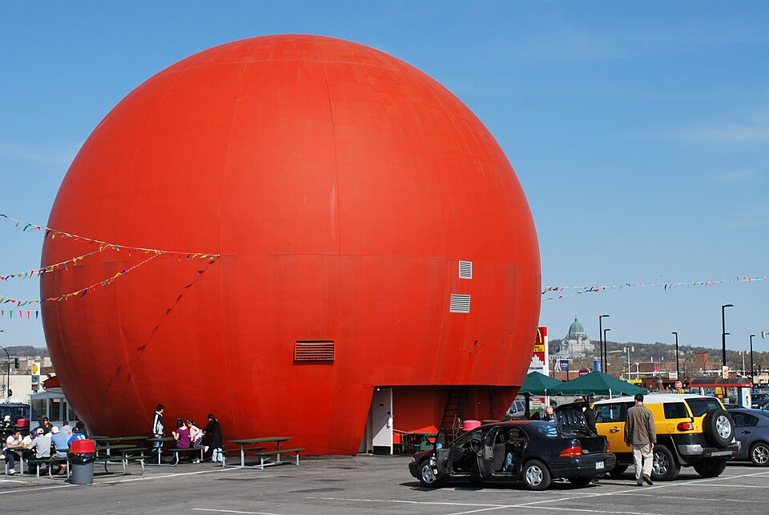
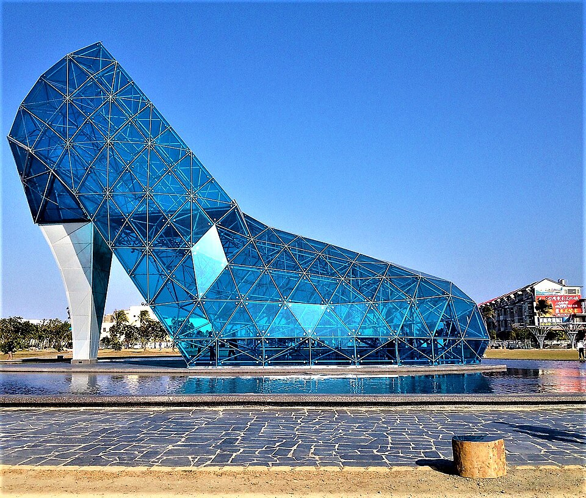
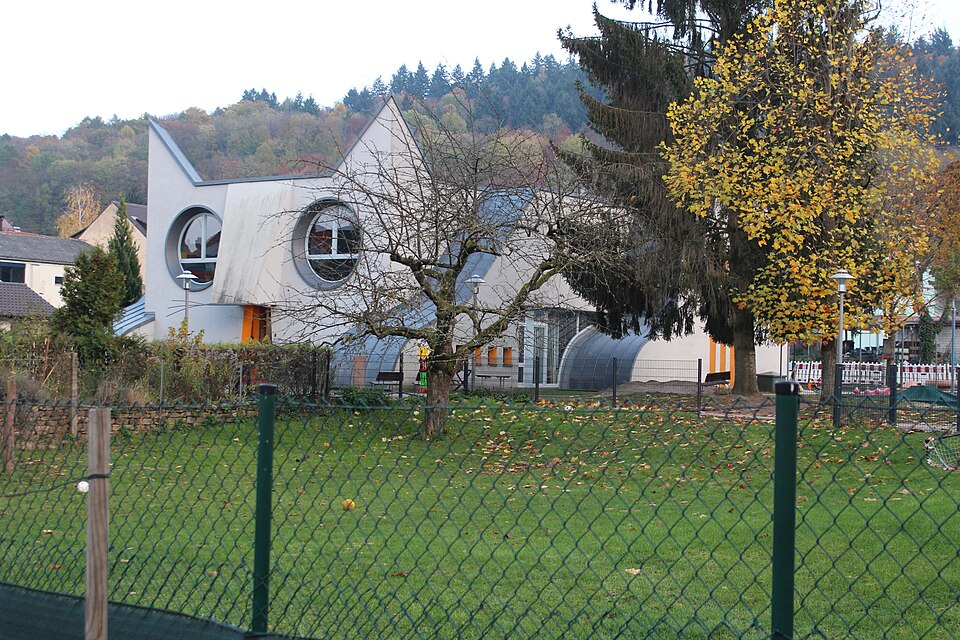

+++
title = "Picture This: Famous Buildings"
description = "Look closely at each picture and name the city, the story or the oddity behind some of the world's best-known and strangest buildings."
licence = "CC BY-SA 4.0"
time_limit = 20
max_points = 1000
scoring = "linear"
floor = 0.5

[[sources]]
title = "Puerta del Sol"
url = "https://en.wikipedia.org/wiki/Puerta_del_Sol"
revision = "2026-09-07"

[[sources]]
title = "Novelty architecture"
url = "https://en.wikipedia.org/wiki/Novelty_architecture"
revision = "2026-10-10"

[[images]]
file = "images/2026-09-03-puerta-del-sol-in-madrid-spain.jpg"
author = "Matt Joseph"
licence = "CC BY-SA 4.0"
source = "https://commons.wikimedia.org/wiki/File:2026-09-03_-_Puerta_del_Sol_in_Madrid_Spain.jpg"

[[images]]
file = "images/km-cero.jpg"
author = "Kaetzar"
licence = "CC BY-SA 4.0"
source = "https://commons.wikimedia.org/wiki/File:Km_cero.JPG"

[[images]]
file = "images/puerta-del-sol-de-madrid-the-statue-by-sculptor-antonio-navarro-santafe-madrid-spain-bear-statue.jpg"
author = "Daytonarolexboston"
licence = "CC BY-SA 3.0"
source = "https://commons.wikimedia.org/wiki/File:Puerta_del_Sol_de_Madrid_The_statue_by_sculptor_Antonio_Navarro_Santafe_Madrid_Spain_Bear_Statue.jpg"

[[images]]
file = "images/puerta-del-sol-madrid-king-carlos-and-tio-pepe.jpg"
author = "Sbharris"
licence = "CC BY-SA 4.0"
source = "https://commons.wikimedia.org/wiki/File:Puerta_del_Sol_Madrid_King_Carlos_and_Tio_Pepe.jpg"

[[images]]
file = "images/nochevieja-puertadelsol-2006.jpg"
author = "JP Puerta"
licence = "CC BY 2.0"
source = "https://commons.wikimedia.org/wiki/File:Nochevieja_puertadelsol_2006.jpg"

[[images]]
file = "images/madrid-metro-sol-y-t-o-pepe-140815-204041.jpg"
author = "Barcex"
licence = "CC BY-SA 3.0"
source = "https://commons.wikimedia.org/wiki/File:Madrid_-_Metro_Sol_y_T%C3%ADo_Pepe_-_140815_204041.jpg"

[[images]]
file = "images/elefant-der-bastille.jpg"
author = "Unknown authorUnknown author"
licence = "Public domain"
source = "https://commons.wikimedia.org/wiki/File:Elefant_der_Bastille.jpg"

[[images]]
file = "images/gibeau-orange-julep01.jpg"
author = "Khayman"
licence = "CC BY-SA 3.0"
source = "https://commons.wikimedia.org/wiki/File:Gibeau_Orange_Julep01.JPG"

[[images]]
file = "images/quiz.jpg"
author = "Accord14"
licence = "CC BY-SA 4.0"
source = "https://commons.wikimedia.org/wiki/File:%E9%AB%98%E8%B7%9F%E9%9E%8B%E6%95%99%E5%A0%82.jpg"

[[images]]
file = "images/kindergarten-wolfartsweier14112016-2.jpg"
author = "Zonk43"
licence = "CC BY-SA 3.0"
source = "https://commons.wikimedia.org/wiki/File:Kindergarten_Wolfartsweier14112016_2.JPG"
+++

## This busy square, the Km 0 of Spain's road network, is in which city?

- [ ] Seville
- [ ] Valencia
- [x] Madrid
- [ ] Barcelona

Source: https://en.wikipedia.org/wiki/Puerta_del_Sol

## This plaque marks Km 0 of Spain's radial roads. In which year was Km 0 set up?

- [ ] 1931
- [ ] 1762
- [x] 1857
- [ ] 1898

Source: https://en.wikipedia.org/wiki/Puerta_del_Sol

## This statue, a city's heraldic symbol, shows a bear with what kind of tree?

- [ ] An olive tree
- [ ] An oak tree
- [x] A strawberry tree
- [ ] An orange tree

Source: https://en.wikipedia.org/wiki/Puerta_del_Sol

## This mounted statue shows Charles III of Spain. What was he nicknamed, for his public works?

- [ ] The builder-king
- [ ] The road-king
- [ ] The sun-king
- [x] The mayor-king

Source: https://en.wikipedia.org/wiki/Puerta_del_Sol

## At New Year, crowds here eat how many grapes in time with the clock's bells?

- [ ] 24
- [ ] 10
- [x] 12
- [ ] 7

Source: https://en.wikipedia.org/wiki/Puerta_del_Sol

## Which Metro lines serve the transport hub beneath this square?

- [ ] Lines 4, 5 and 6
- [x] Lines 1, 2 and 3
- [ ] Lines 2, 5 and 10
- [ ] Lines 7 and 8

Source: https://en.wikipedia.org/wiki/Puerta_del_Sol

## This elephant building, planned but never completed, was meant for which city?

- [x] Paris
- [ ] Vienna
- [ ] Rome
- [ ] London

Source: https://en.wikipedia.org/wiki/Novelty_architecture

## This 12-metre orange-shaped restaurant, built in 1966, is in which city?

- [x] Montréal
- [ ] Miami
- [ ] Los Angeles
- [ ] Toronto

Source: https://en.wikipedia.org/wiki/Novelty_architecture

## This shoe-shaped wedding church is in which country?

- [ ] Japan
- [ ] South Korea
- [ ] China
- [x] Taiwan

Source: https://en.wikipedia.org/wiki/Novelty_architecture

## This cat-shaped building in Germany is used as what?

- [x] A kindergarten
- [ ] A cat museum
- [ ] A pet shop
- [ ] A café

Source: https://en.wikipedia.org/wiki/Novelty_architecture
