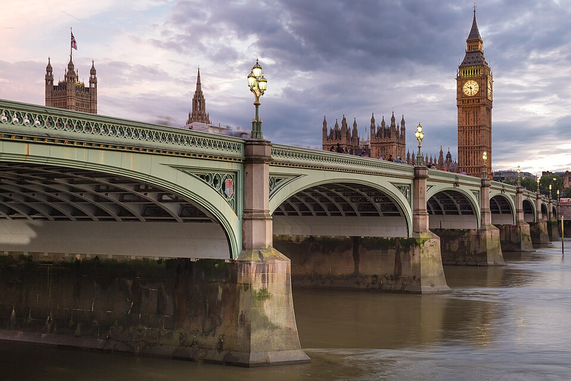
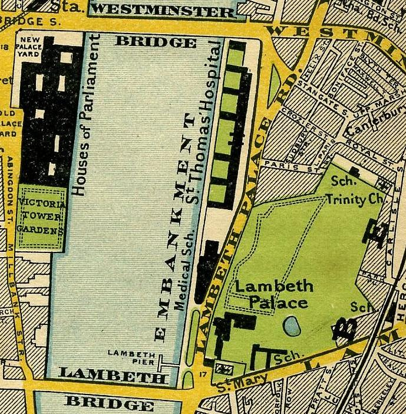
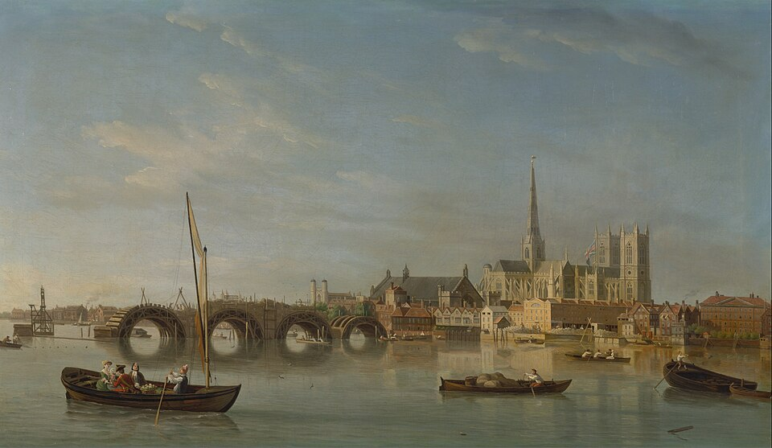
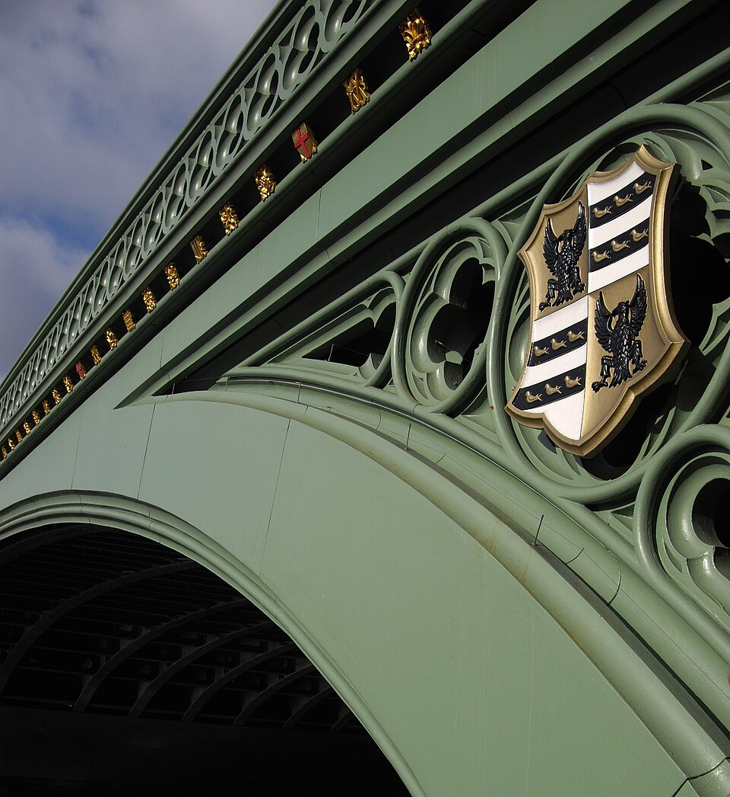
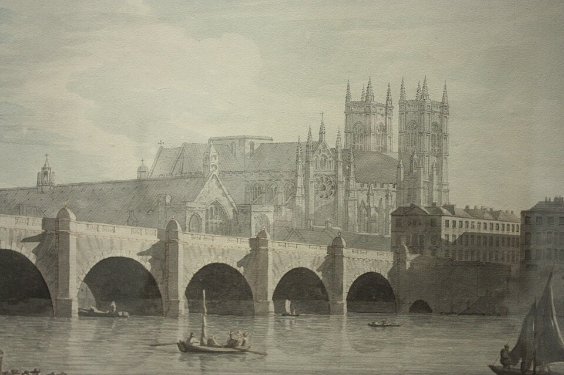
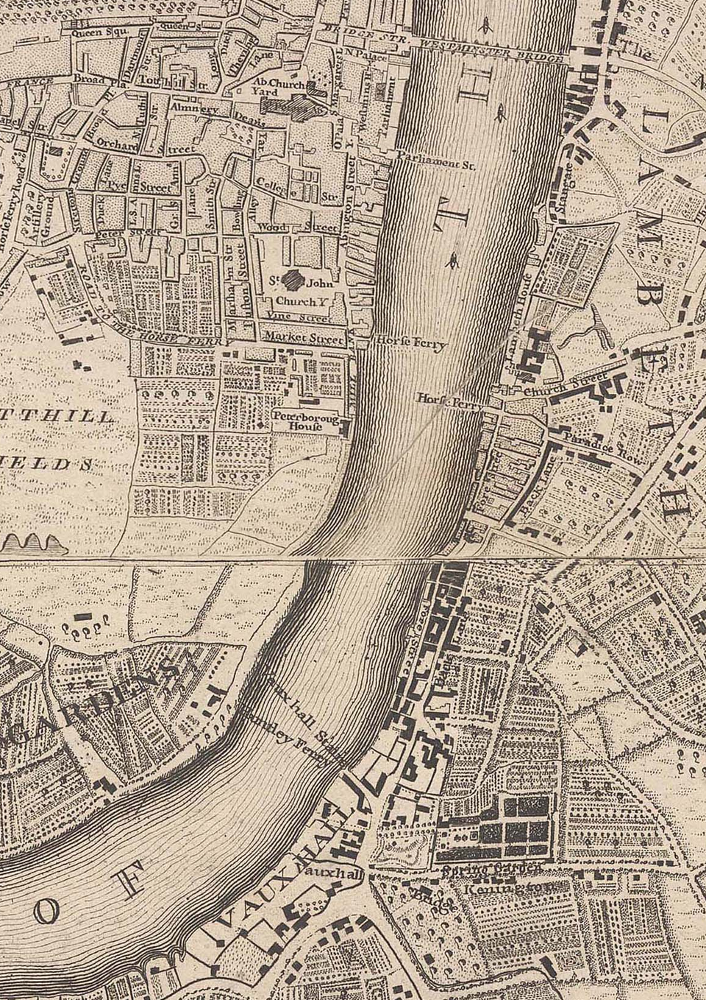
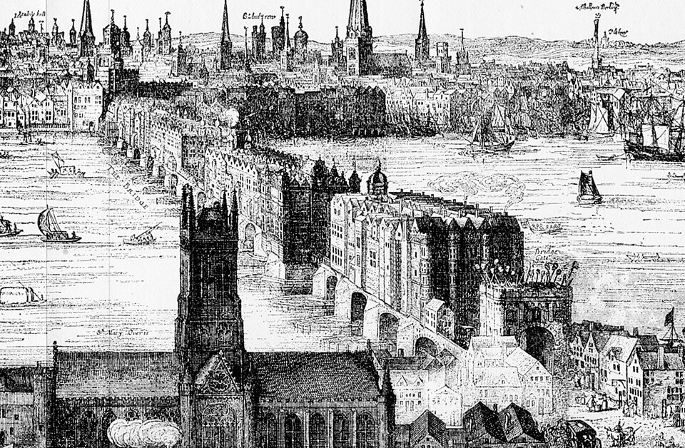
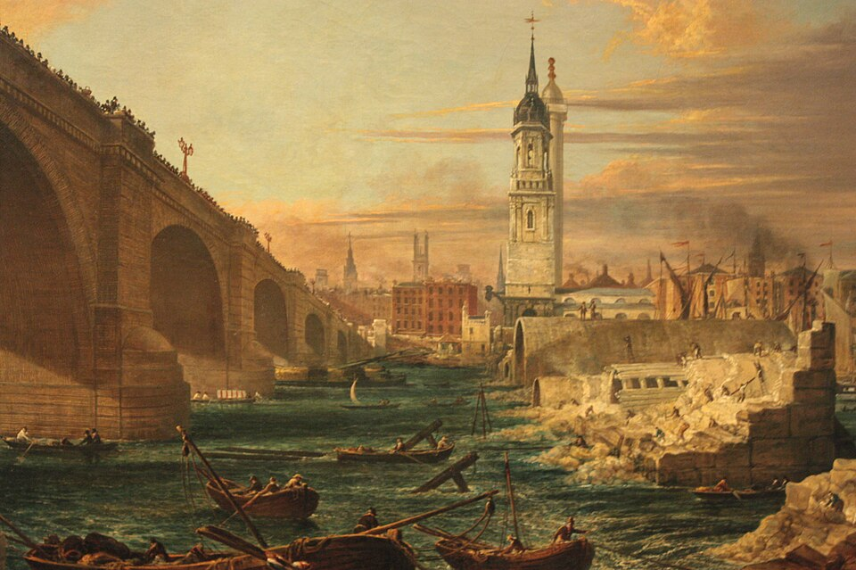
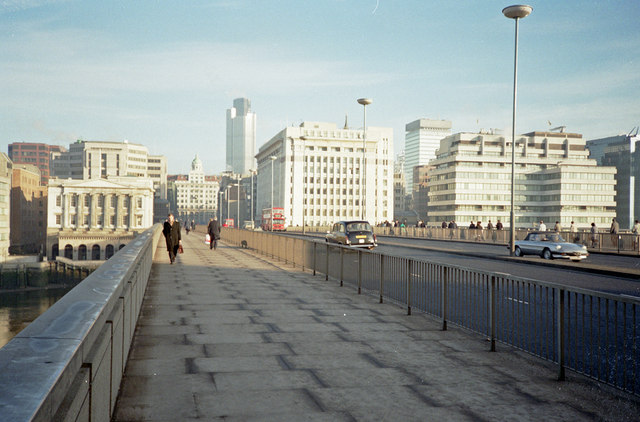
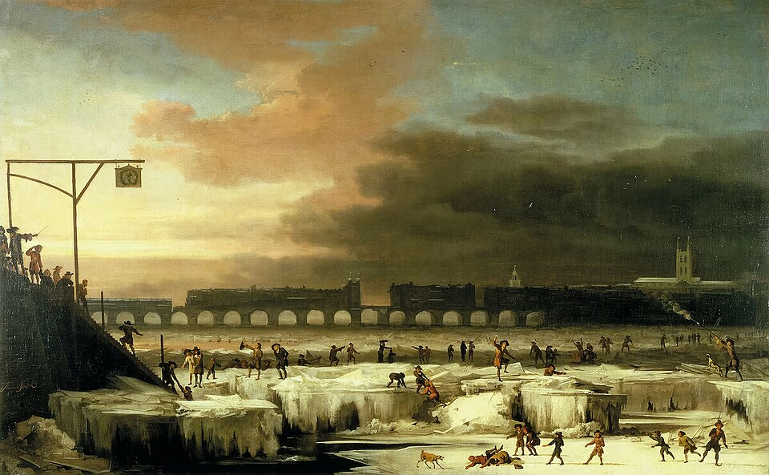

+++
title = "Picture This: Thames Bridges"
description = "Ten picture questions about London's bridges over the Thames, from Roman timber to Victorian iron."
licence = "CC BY-SA 4.0"
time_limit = 20
max_points = 1000
scoring = "linear"
floor = 0.5

[[sources]]
title = "Westminster Bridge"
url = "https://en.wikipedia.org/wiki/Westminster_Bridge"
revision = "2026-10-18"

[[sources]]
title = "London Bridge"
url = "https://en.wikipedia.org/wiki/London_Bridge"
revision = "2026-11-01"

[[sources]]
title = "Lambeth Bridge"
url = "https://en.wikipedia.org/wiki/Lambeth_Bridge"
revision = "2026-09-09"

[[sources]]
title = "Vauxhall Bridge"
url = "https://en.wikipedia.org/wiki/Vauxhall_Bridge"
revision = "2026-11-08"

[[images]]
file = "images/westminster-bridge-and-palace-of-westminster.jpg"
author = "Martin Dunst"
licence = "CC BY-SA 4.0"
source = "https://commons.wikimedia.org/wiki/File:Westminster_Bridge_and_Palace_of_Westminster.jpg"

[[images]]
file = "images/westminster-bridge-and-lambeth-bridge-1897.jpg"
author = "Stanford's Map Of Central London 1897"
licence = "Public domain"
source = "https://commons.wikimedia.org/wiki/File:Westminster_Bridge_and_Lambeth_Bridge_1897.jpg"

[[images]]
file = "images/samuel-scott-the-building-of-westminster-bridge-google-art-project.jpg"
author = "Samuel Scott"
licence = "Public domain"
source = "https://commons.wikimedia.org/wiki/File:Samuel_Scott_-_The_Building_of_Westminster_Bridge_-_Google_Art_Project.jpg"

[[images]]
file = "images/westminster-bridge-detail.jpg"
author = "Stacey Meadwell"
licence = "CC BY 2.0"
source = "https://commons.wikimedia.org/wiki/File:Westminster_Bridge_(detail).jpg"

[[images]]
file = "images/westminster-bridge-by-joseph-farington-1789.jpg"
author = "Joseph Farington"
licence = "CC BY-SA 4.0"
source = "https://commons.wikimedia.org/wiki/File:Westminster_Bridge_by_Joseph_Farington,_1789.jpg"

[[images]]
file = "images/rocque-vauxhall-and-westminster-cropped.png"
author = "John Rocque"
licence = "Public domain"
source = "https://commons.wikimedia.org/wiki/File:Rocque_Vauxhall_and_Westminster_(cropped).png"

[[images]]
file = "images/london-bridge-1616-by-claes-van-visscher.jpg"
author = "Angr"
licence = "Public domain"
source = "https://commons.wikimedia.org/wiki/File:London_Bridge_(1616)_by_Claes_Van_Visscher.jpg"

[[images]]
file = "images/the-demolition-of-old-london-bridge-1832-guildhall-gallery-london.jpg"
author = "Stephencdickson"
licence = "CC BY-SA 4.0"
source = "https://commons.wikimedia.org/wiki/File:The_Demolition_of_Old_London_Bridge,_1832,_Guildhall_Gallery,_London.JPG"

[[images]]
file = "images/london-bridge-geograph-org-uk-478726.jpg"
author = "David Wright"
licence = "CC BY-SA 2.0"
source = "https://commons.wikimedia.org/wiki/File:London_Bridge_-_geograph.org.uk_-_478726.jpg"

[[images]]
file = "images/the-frozen-thames-1677-by-abraham-hondius.jpg"
author = "Abraham Hondius"
licence = "Public domain"
source = "https://commons.wikimedia.org/wiki/File:The_Frozen_Thames_1677_by_Abraham_Hondius.jpg"
+++

## This bridge is painted green, the colour of the seats in which chamber?

- [ ] Westminster Abbey's choir
- [x] The House of Commons
- [ ] The House of Lords
- [ ] The Royal Courts of Justice

Source: https://en.wikipedia.org/wiki/Westminster_Bridge

## On this 1897 map, Lambeth Bridge is upstream of Westminster Bridge. What colour is Lambeth Bridge mainly painted?

- [ ] Blue
- [x] Red
- [ ] Black
- [ ] Green

Source: https://en.wikipedia.org/wiki/Lambeth_Bridge

## The first Westminster Bridge, built 1739–1750, was overseen by which Swiss engineer?

- [ ] Robert Mylne
- [ ] John Rennie
- [ ] Isambard Kingdom Brunel
- [x] Charles Labelye

Source: https://en.wikipedia.org/wiki/Westminster_Bridge

## How many cast-iron arches does the current Westminster Bridge, opened in 1862, have?

- [x] Seven
- [ ] Nine
- [ ] Five
- [ ] Eleven

Source: https://en.wikipedia.org/wiki/Westminster_Bridge

## Which poet wrote a famous poem while standing on Westminster Bridge in 1802?

- [ ] Lord Byron
- [x] William Wordsworth
- [ ] Percy Bysshe Shelley
- [ ] John Keats

Source: https://en.wikipedia.org/wiki/Westminster_Bridge

## Vauxhall, shown on this 1746 map, is named after the manor of which 13th-century mercenary?

- [x] Falkes de Breauté
- [ ] Simon de Montfort
- [ ] Hubert de Burgh
- [ ] William Marshal

Source: https://en.wikipedia.org/wiki/Vauxhall_Bridge

## Old London Bridge, seen here in 1616, had a chapel dedicated to which murdered archbishop?

- [ ] Thomas Cranmer
- [ ] Anselm
- [ ] William Laud
- [x] Thomas Becket

Source: https://en.wikipedia.org/wiki/London_Bridge

## Old London Bridge was demolished in the 1830s. Who built the very first London Bridge, around AD 50?

- [x] The Romans
- [ ] The Normans
- [ ] The Saxons
- [ ] The Danes

Source: https://en.wikipedia.org/wiki/London_Bridge

## What type of bridge is the current London Bridge, opened in 1973?

- [x] A box girder bridge
- [ ] A cable-stayed bridge
- [ ] A stone arch bridge
- [ ] A suspension bridge

Source: https://en.wikipedia.org/wiki/London_Bridge

## Until Putney Bridge opened in 1729, London Bridge was the only road crossing below which town?

- [ ] Richmond
- [ ] Kew
- [x] Kingston upon Thames
- [ ] Hampton

Source: https://en.wikipedia.org/wiki/London_Bridge
