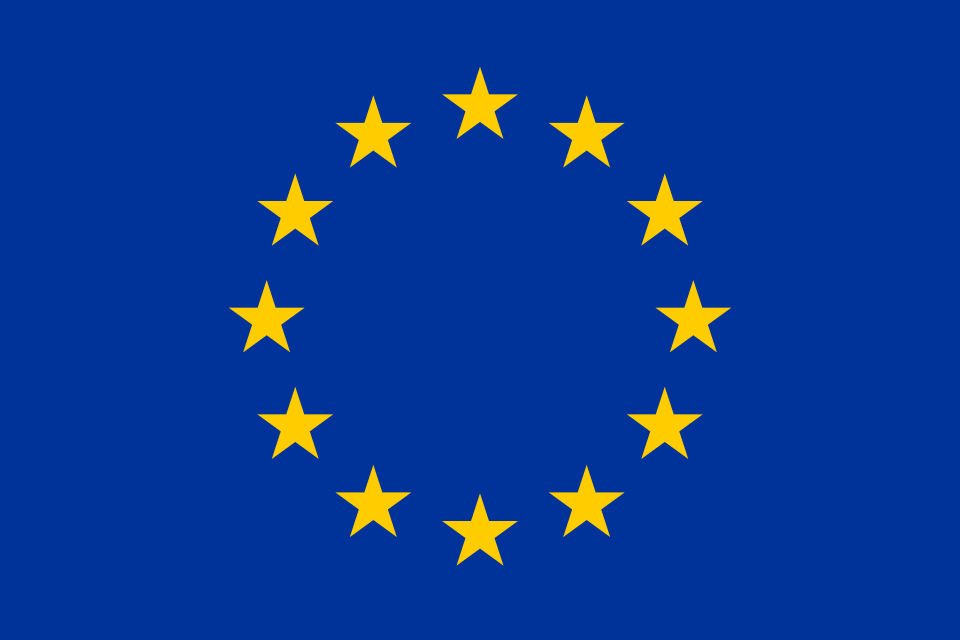

+++
title = "Stars, Stripes and Squabbles: Flags of Europe"
description = "Test what you know about the blue-and-gold flag of Europe, the designs that lost out and the stories behind it."
licence = "CC BY-SA 4.0"
time_limit = 20
max_points = 1000
scoring = "linear"
floor = 0.5

[[sources]]
title = "Flag of Europe"
url = "https://en.wikipedia.org/wiki/Flag_of_Europe"
revision = "2026-11-09"

[[sources]]
title = "Europe of 100 Flags"
url = "https://en.wikipedia.org/wiki/Europe_of_100_Flags"
revision = "2026-04-03"

[[images]]
file = "images/flag-of-europe.png"
author = "User:Verdy p, User:-xfi-, User:Paddu, User:Nightstallion, User:Funakoshi, User:Jeltz, User:Dbenbenn, User:Zscout370"
licence = "Public domain"
source = "https://commons.wikimedia.org/wiki/File:Flag_of_Europe.svg"
+++

## How many golden stars are on the flag of Europe?

- [x] Twelve
- [ ] Twenty-seven
- [ ] Ten
- [ ] Fifteen

Source: https://en.wikipedia.org/wiki/Flag_of_Europe

## Which organisation adopted this flag in 1955?

- [x] The Council of Europe
- [ ] The European Union
- [ ] NATO
- [ ] The United Nations

Source: https://en.wikipedia.org/wiki/Flag_of_Europe

## What are the proportions of the flag of Europe, height to width?

- [x] 2:3
- [ ] 3:5
- [ ] 1:1
- [ ] 1:2

Source: https://en.wikipedia.org/wiki/Flag_of_Europe

## Which country objected to a fifteen-star design because one star would stand for the Saar?

- [x] West Germany
- [ ] Belgium
- [ ] France
- [ ] Turkey

Source: https://en.wikipedia.org/wiki/Flag_of_Europe

## Turkey rejected Richard von Coudenhove-Kalergi's proposed flag because it featured what?

- [ ] Olympic rings
- [x] A red cross
- [ ] A green letter E
- [ ] A crescent moon

Source: https://en.wikipedia.org/wiki/Flag_of_Europe

## A single large yellow star on blue was rejected for looking like the flag of where?

- [x] The Belgian Congo
- [ ] Somalia
- [ ] Vietnam
- [ ] Kosovo

Source: https://en.wikipedia.org/wiki/Flag_of_Europe

## Where was the new flag unveiled on 13 December 1955?

- [ ] Strasbourg Cathedral
- [x] Château de la Muette, Paris
- [ ] Palazzo Venezia, Rome
- [ ] Palais de la Nation, Brussels

Source: https://en.wikipedia.org/wiki/Flag_of_Europe

## The flag was adopted on 8 December, which is the date of which Catholic feast?

- [ ] All Saints
- [ ] The Annunciation
- [ ] The Assumption
- [x] The Immaculate Conception

Source: https://en.wikipedia.org/wiki/Flag_of_Europe

## One interpretation says the circle of stars stands for which constellation?

- [ ] Cassiopeia
- [ ] Orion
- [ ] Ursa Major
- [x] Corona Borealis

Source: https://en.wikipedia.org/wiki/Flag_of_Europe

## Which Breton nationalist came up with the idea of a 'Europe of 100 Flags'?

- [ ] Paul M. G. Lévy
- [x] Yann Fouéré
- [ ] Salvador de Madariaga
- [ ] Arsène Heitz

Source: https://en.wikipedia.org/wiki/Europe_of_100_Flags
