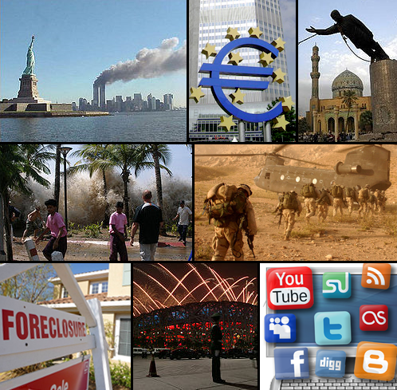

+++
title = "Where in the World?"
description = "Twenty questions on the cities and countries behind the headlines of the 2000s and beyond."
licence = "CC BY-SA 4.0"
time_limit = 20
max_points = 1000
scoring = "linear"
floor = 0.5

[[sources]]
title = "2000s"
url = "https://en.wikipedia.org/wiki/2000s"
revision = "2026-11-16"

[[sources]]
title = "Non-government reactions to the Russian invasion of Ukraine"
url = "https://en.wikipedia.org/wiki/Non-government_reactions_to_the_Russian_invasion_of_Ukraine"
revision = "2026-11-18"

[[images]]
file = "images/2000s-decade-montage3.png"
author = "A derivative work by CatJar, from a variety of images creditted above."
licence = "CC BY-SA 3.0"
source = "https://commons.wikimedia.org/wiki/File:2000s_decade_montage3.png"
+++

## This montage shows notable events from which decade?

- [ ] The 2010s
- [x] The 2000s
- [ ] The 1990s
- [ ] The 1980s

Source: https://en.wikipedia.org/wiki/2000s

## In which city did train bombings kill 192 people in 2004?

- [ ] Lisbon
- [x] Madrid
- [ ] Rome
- [ ] Barcelona

Source: https://en.wikipedia.org/wiki/2000s

## Bombings in 2002 killed 202 people on which Indonesian island?

- [ ] Sumatra
- [x] Bali
- [ ] Lombok
- [ ] Java

Source: https://en.wikipedia.org/wiki/2000s

## Which Indian city suffered attacks in 2008 that killed 175 people?

- [x] Mumbai
- [ ] Delhi
- [ ] Kolkata
- [ ] Chennai

Source: https://en.wikipedia.org/wiki/2000s

## Which Moroccan city was hit by bombings in 2003?

- [ ] Marrakesh
- [ ] Rabat
- [x] Casablanca
- [ ] Tangier

Source: https://en.wikipedia.org/wiki/2000s

## In 2002, a theatre hostage crisis that killed 171 people took place in which city?

- [x] Moscow
- [ ] Kazan
- [ ] St Petersburg
- [ ] Novosibirsk

Source: https://en.wikipedia.org/wiki/2000s

## Which Turkish city suffered bombings in 2003 that killed 57 people?

- [ ] Antalya
- [ ] Ankara
- [x] Istanbul
- [ ] Izmir

Source: https://en.wikipedia.org/wiki/2000s

## The Pentagon, attacked on 11 September 2001, is in which county of Virginia?

- [x] Arlington County
- [ ] Prince William County
- [ ] Fairfax County
- [ ] Loudoun County

Source: https://en.wikipedia.org/wiki/2000s

## The 2006 war with Hezbollah was fought in southern Lebanon and the north of which country?

- [ ] Syria
- [ ] Jordan
- [x] Israel
- [ ] Egypt

Source: https://en.wikipedia.org/wiki/2000s

## Bombings of Yazidi communities in 2007 killed 796 people in which country?

- [ ] Turkey
- [ ] Syria
- [x] Iraq
- [ ] Iran

Source: https://en.wikipedia.org/wiki/2000s

## In 2009, the Boko Haram uprising killed over 1,000 people in which country?

- [x] Nigeria
- [ ] Niger
- [ ] Chad
- [ ] Mali

Source: https://en.wikipedia.org/wiki/2000s

## In 2005, a major earthquake struck which country?

- [ ] China
- [x] Pakistan
- [ ] Japan
- [ ] Iran

Source: https://en.wikipedia.org/wiki/2000s

## The deadliest natural disaster of the 21st century struck nations around which ocean in 2004?

- [x] Indian Ocean
- [ ] Pacific Ocean
- [ ] Atlantic Ocean
- [ ] Arctic Ocean

Source: https://en.wikipedia.org/wiki/2000s

## Which war, the deadliest conflict since World War II, ended in 2003?

- [ ] Angolan Civil War
- [x] Second Congo War
- [ ] Sierra Leone Civil War
- [ ] Second Liberian Civil War

Source: https://en.wikipedia.org/wiki/2000s

## In British English, the decade of the 2000s is often called the…

- [ ] Aughts
- [x] Noughties
- [ ] Oh-ohs
- [ ] Double zeros

Source: https://en.wikipedia.org/wiki/2000s

## A demonstration in support of Russia's invasion of Ukraine was held in Bangui, capital of which country?

- [ ] Cameroon
- [ ] Republic of the Congo
- [ ] Chad
- [x] Central African Republic

Source: https://en.wikipedia.org/wiki/Non-government_reactions_to_the_Russian_invasion_of_Ukraine

## South Africa's Western Cape government lit up its buildings in which country's colours in 2022?

- [ ] Russia
- [ ] Poland
- [ ] South Africa
- [x] Ukraine

Source: https://en.wikipedia.org/wiki/Non-government_reactions_to_the_Russian_invasion_of_Ukraine

## Israel's United Hatzalah first sent medics to help Ukrainian refugees in which country?

- [ ] Hungary
- [ ] Romania
- [ ] Slovakia
- [x] Moldova

Source: https://en.wikipedia.org/wiki/Non-government_reactions_to_the_Russian_invasion_of_Ukraine

## Sarah, Duchess of York, travelled to which country in March 2022?

- [ ] Romania
- [ ] Moldova
- [ ] Lithuania
- [x] Poland

Source: https://en.wikipedia.org/wiki/Non-government_reactions_to_the_Russian_invasion_of_Ukraine

## Anthony Albanese, who called the invasion "a grave moment for humanity", led the opposition in which country?

- [ ] New Zealand
- [x] Australia
- [ ] Canada
- [ ] United Kingdom

Source: https://en.wikipedia.org/wiki/Non-government_reactions_to_the_Russian_invasion_of_Ukraine
